<div align="center">

# Data Narrator

**Your business data, explained in plain words.**

Point it at messy Excel sheets or a database. It works out what every column means, writes a short report of what changed, what is owed and what needs attention, runs the daily MIS work, and sends the owner a morning brief on WhatsApp or email.

[](LICENSE)


[](CONTRIBUTING.md)

[Try it](#try-it-in-a-minute) · [Screenshots](#a-look-around) · [Run it](#run-it) · [How it works](#how-it-works) · [Contribute](CONTRIBUTING.md)

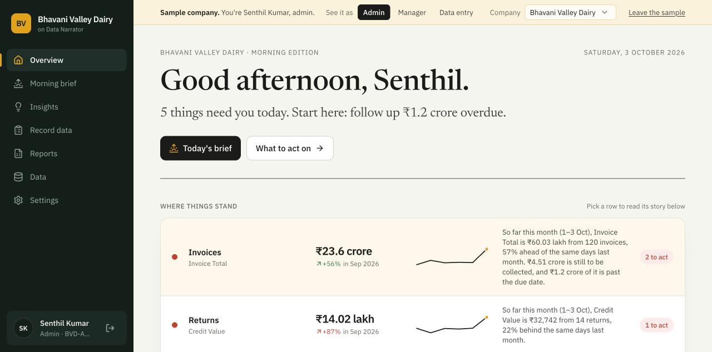

</div>

---

## Why this exists

Most mid-size companies in India run on Excel and one overworked MIS person. Every morning that person collects sheets from branches, cleans and merges them, builds the daily report and sends it around. By the time anyone reads it, the day has started. Problems like falling milk quality at one collection centre or a customer who stopped paying get noticed at the month-end review, if at all.

BI tools like Power BI and Tableau are excellent, but someone has to build and maintain the dashboards, and they only show data. Data Narrator does the MIS work itself:

| | Data Narrator | Typical BI dashboard |
|---|---|---|
| **Setup** | Upload a messy Excel file or connect a database. No column mapping. | A data model and formulas built by an analyst |
| **Output** | Written sentences: *"Fat % at Kodumudi fell to 3.76 from its usual 4.11, while other centres held steady."* | Charts you have to read and interpret |
| **Daily work** | Entry forms, checks, Employee ID sign-off, the daily report, who hasn't sent figures | Read-only |
| **Delivery** | A morning brief on WhatsApp or email | You open the dashboard |
| **Indian context** | ₹ lakh and crore, GST, 30/60/90-day overdue, dd-mm dates, messy Excel exports | Configured by hand |
| **Hosting** | One Docker container on your own server, works offline | Usually cloud |

It isn't a replacement for a BI team. It's for the companies that don't have one, and for the MIS desk underneath the ones that do.

## Try it in a minute

Open the front page and pick a sample company and a role, or log in with one of these. The password is `demo123` for all of them.

| Company | What it is | Admin | Manager | Data entry |
|---|---|---|---|---|
| **Bhavani Valley Dairy** | Dairy, Erode: milk collection by village centre, production, distributor invoices, returns | `BVD-ADMIN` | `BVD-MANAGER` | `BVD-ENTRY` |
| **Narmada Electricals** | Electricals distributor, Pune: invoices, customers, products, payments | `NE-ADMIN` | `NE-MANAGER` | `NE-ENTRY` |
| **Sahyadri Roadlines** | Transport, Pune: trips, fuel, vehicles, freight bills | `SRL-ADMIN` | `SRL-MANAGER` | `SRL-ENTRY` |

The companies are made up. Each has six months of realistic data with real patterns planted in it (seasonality, a slipping salesperson, a collection centre with falling fat %, late payers, duplicate invoice numbers), regenerated daily so it always ends today. Each lives in its own workspace, separate from your company's data, and can't be changed in ways that would spoil it for the next visitor. Set `DN_DEMOS=false` to turn them off on a private server.

## A look around

<table>
<tr>
<td width="50%">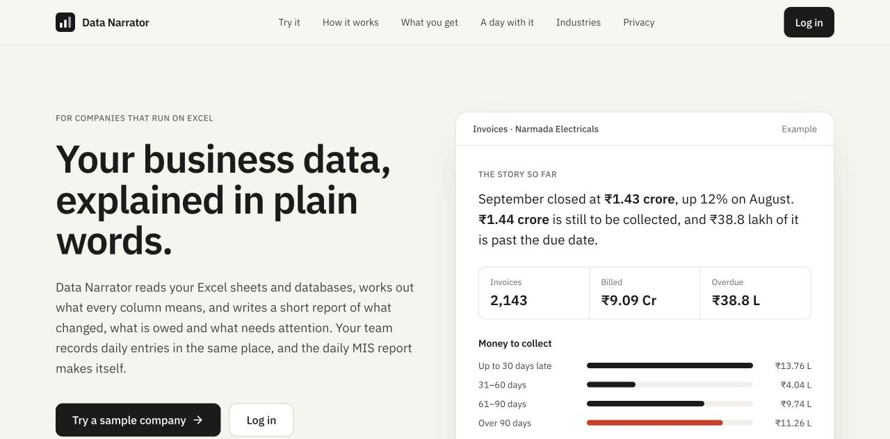<br><b>Front page.</b> What it does, in plain words.</td>
<td width="50%">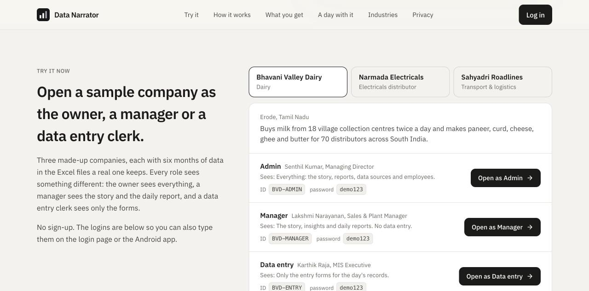<br><b>Try it.</b> Open a sample company as the owner, a manager or a data entry clerk.</td>
</tr>
<tr>
<td>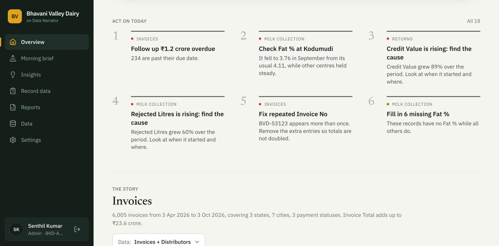<br><b>Act on today.</b> The most urgent things across the whole business, ranked: money owed, then quality problems, then data fixes.</td>
<td>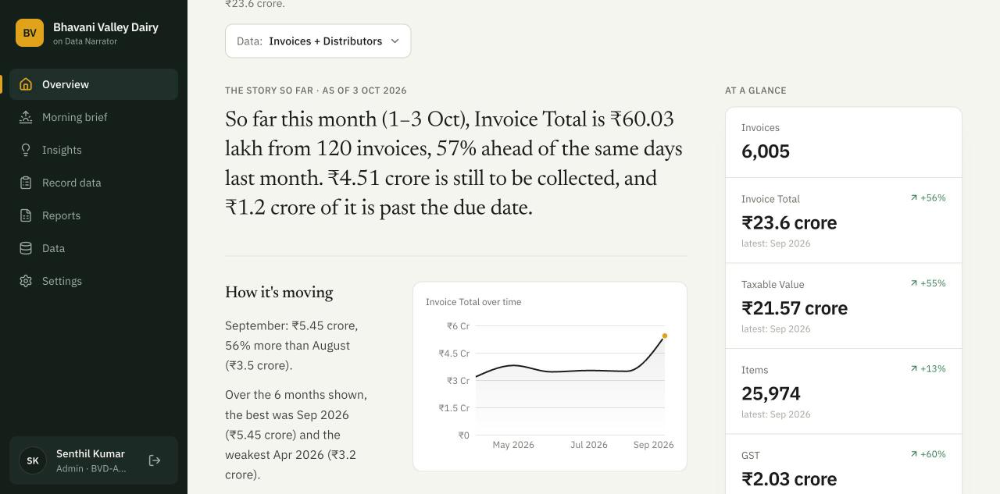<br><b>The story.</b> A written report for each area, with the chart and numbers behind every paragraph.</td>
</tr>
<tr>
<td>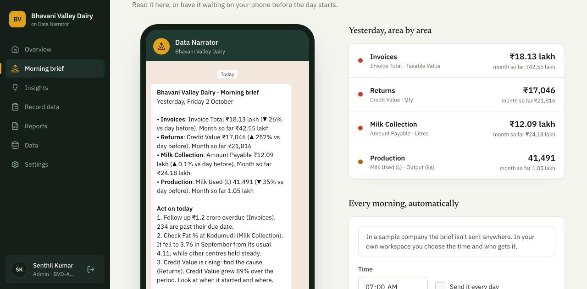<br><b>Morning brief.</b> Yesterday by area, what to act on, who went quiet. Share on WhatsApp in one tap, or have it sent every morning.</td>
<td>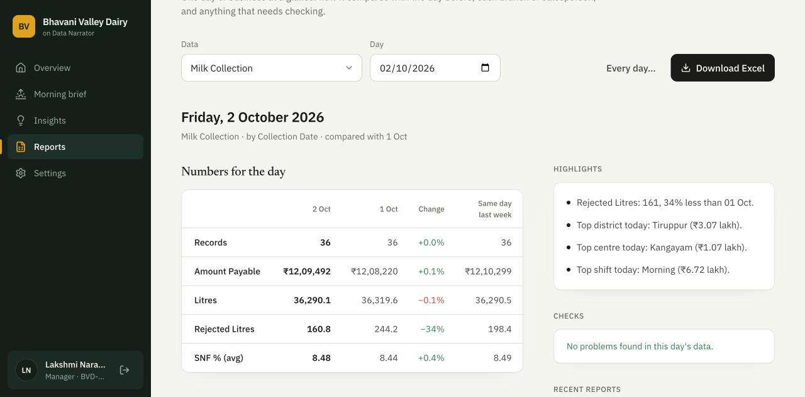<br><b>Daily report.</b> The day against the day before and last week, month to date, by branch or centre, with checks. Download as Excel.</td>
</tr>
<tr>
<td>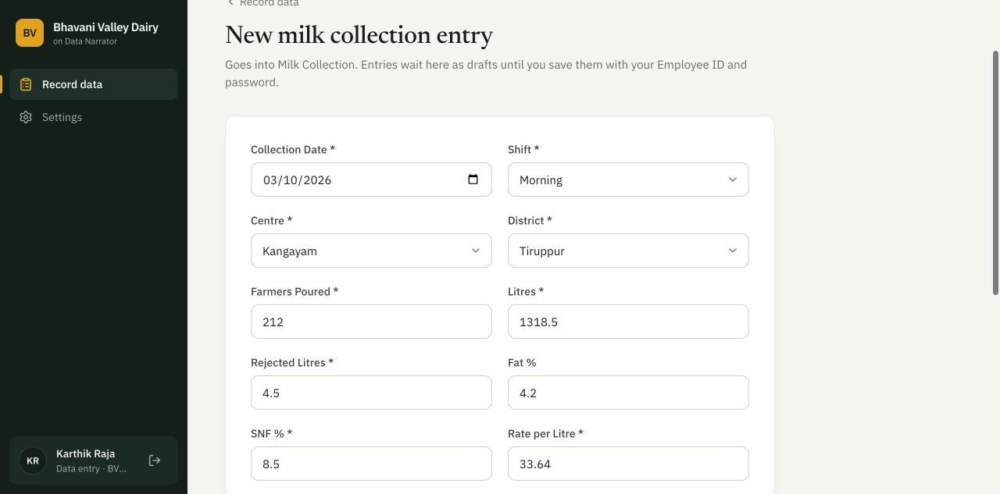<br><b>Entry forms.</b> Built from your own columns, with dropdowns, limits and duplicate checks. Entries are saved only when an employee signs off with their ID and password.</td>
<td>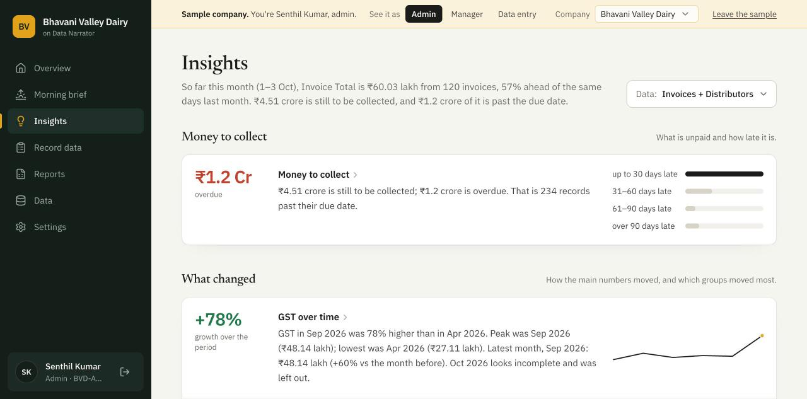<br><b>Insights.</b> Money to collect, what changed and by whom, who matters most, unusual values and data problems.</td>
</tr>
</table>

<p align="center">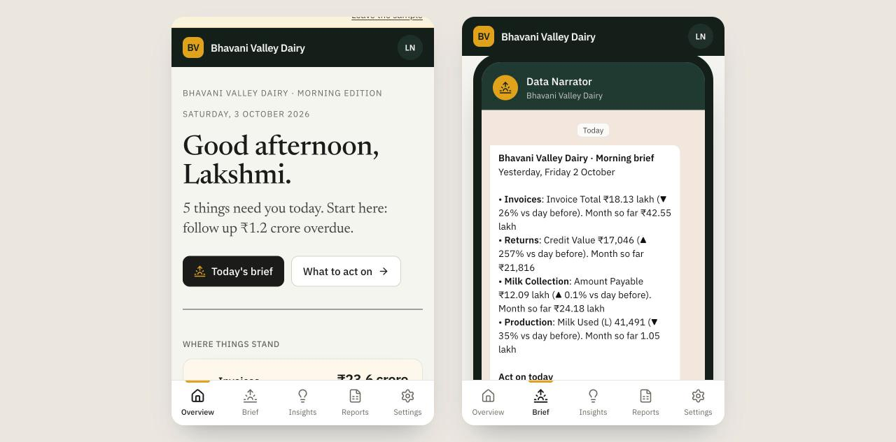<br><b>On a phone.</b> Owners read the morning edition and the brief on their phones. There's also an Android app.</p>

## What it does

**Reads real-world Excel.** Title rows, merged cells, two-row headers, several tables on one sheet, subtotal and "Grand Total" rows, `₹1,234` and `(500)` stored as text, months laid out as columns, the same layout repeated on twelve sheets. Every decision is shown under **Data → How we read it**.

**Works with any schema.** Each column gets a role (amount, category, date, name, ID, property) from its values, not its name, and the insights come from those roles. It knows that rejections and returns going up is bad news, that a credit limit or odometer reading shouldn't be added up, and that "Customer since" isn't a timeline.

**Joins tables automatically.** Shared keys such as `Customer ID` are detected and related tables are combined, so invoices get customer names and cities.

**Writes the story.** This month against last month, how it's moving, where it comes from, what changed by branch or salesperson, which group drifted on its own, who matters most, money to collect (30/60/90+ days overdue and who owes it) and things worth checking. Amounts in ₹ lakh and crore.

**Runs the daily MIS work.**
- entry forms generated from each table, with dropdowns, limits, next numbers and duplicate checks
- drafts saved only when an employee **signs off with Employee ID and password**, with optional write-back to the source PostgreSQL or MySQL database
- sheets with the same layout appended to the same table, with a history of who added what and when
- the **daily report** on screen or as Excel: today against the previous day and last week, month to date, per-branch tables, checks and missing submissions, on demand or scheduled
- blank **Excel templates** with dropdowns

**Sends a morning brief.** Every area's numbers for yesterday, the top three things to act on, and which sites sent nothing, by email or WhatsApp at a time you choose.

**Simple roles.** Data entry staff see the forms. Managers see the story, insights and reports. Admins see everything, plus data sources and employees.

**Scales.** Built on DuckDB and Parquet. 100 million rows were analysed in about 23 seconds on an 8 GB laptop.

**Self-hosted.** One Docker container. Your data stays on your servers.

## Run it

**Docker** (recommended: on-premise or any cloud VM)

```bash
docker compose up --build
# open http://localhost:8000
```

**From source**

```bash
# backend
cd backend
python3.12 -m venv .venv && source .venv/bin/activate
pip install -e ".[dev]"
uvicorn datanarrator.api.main:app --reload       # http://localhost:8000

# frontend (dev server on :5173, proxies /api to :8000)
cd frontend && npm install && npm run dev
```

On first open, create your admin account (Employee ID and password), then add employees under **Settings**. The files in `samples/` are good for a first try: `Daily Branch Sales.xlsx` is a daily MIS sheet and `Sharma Traders FY25.xlsx` is a deliberately messy company workbook.

<details>
<summary><b>Android app</b></summary>

```bash
cd frontend
npm run build && npx cap sync android
cd android && ./gradlew assembleDebug        # needs JDK 21+ and the Android SDK (ANDROID_HOME)
# → android/app/build/outputs/apk/debug/app-debug.apk   (install: adb install -r app-debug.apk)
```

Or run `npm run android` to open the project in Android Studio. On first launch the app asks for the server address, for example `192.168.1.20:8000` on your network, or `10.0.2.2:8000` from the Android emulator to a server on the same computer.

</details>

**Databases when running in Docker:** a database on the same machine is reachable at `host.docker.internal`, not `localhost`.

## Data sources

| Source | How |
|---|---|
| Excel `.xlsx .xlsm .xls .xlsb .ods`, CSV/TSV, Parquet, JSON | Upload (several at once; related files get joined) |
| Google Sheets / Drive, OneDrive, SharePoint, Dropbox | Paste the share link |
| Amazon S3, Google Cloud Storage, Azure Blob, Cloudflare R2, MinIO | `s3://bucket/path/*.parquet` and keys |
| PostgreSQL, MySQL | Host, database, user (a read-only copy; the password isn't stored) |

## How it works

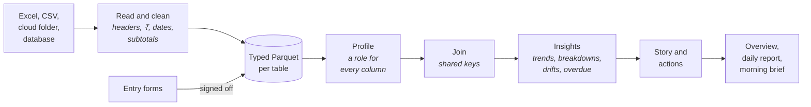

| Path | What |
|---|---|
| `backend/datanarrator/connectors/excel.py` | Understanding messy Excel |
| `backend/datanarrator/connectors/normalize.py` | Text to numbers and dates |
| `backend/datanarrator/engine/profile.py` | Column roles |
| `backend/datanarrator/engine/insights.py` | Insight generation and ranking |
| `backend/datanarrator/engine/narrate.py` | The written story |
| `backend/datanarrator/engine/actions.py` | The "act on today" rules |
| `backend/datanarrator/engine/relationships.py` | Automatic joins |
| `backend/datanarrator/mis/` | Entry forms, sign-off, daily reports, schedules |
| `backend/datanarrator/brief.py` | The morning brief and its delivery |
| `backend/datanarrator/demos/` | The sample companies |
| `frontend/src` | React app (web, and Android through Capacitor) |

Tests: `cd backend && pytest`

## Configuration

Settings are environment variables.

| Variable | Default | What it does |
|---|---|---|
| `DN_STORAGE_DIR` | `backend/storage` | Where data and the catalog are kept |
| `DN_COMPANY_NAME` | | Your company's name, shown in the app and the brief |
| `DN_PUBLIC_URL` | | Where people open the app; the link at the end of the brief |
| `DN_DEMOS` | `true` | Show the sample companies and their public logins |
| `DN_DAYFIRST` | `true` | Read `03-04-2018` as 3 April |
| `DN_DUCKDB_MEMORY_LIMIT` | `4GB` | Memory for the analysis engine |
| `DN_ANALYSIS_WORKERS` | `2` | Tables analysed at the same time |
| `DN_PROFILE_SAMPLE_ROWS` | `1000000` | Profile on a sample above this size; totals always use all rows |
| `DN_CORS_ORIGINS` | `*` | Allowed origins for the API |

**Morning brief delivery.** "Share on WhatsApp" works with no setup. To send the brief automatically every morning:

- **Email:** `DN_SMTP_HOST`, `DN_SMTP_PORT` (587), `DN_SMTP_USER`, `DN_SMTP_PASSWORD`, `DN_SMTP_FROM`
- **WhatsApp:** `DN_WHATSAPP_TOKEN` and `DN_WHATSAPP_PHONE_ID` from the Meta WhatsApp Cloud API. Outside a 24-hour chat window, WhatsApp only delivers pre-approved message templates.

## Roadmap

- [x] Daily report on screen and as Excel, on demand or scheduled
- [x] Morning brief by email, and WhatsApp through the Cloud API or a share link
- [ ] An approved WhatsApp template, so the brief arrives without opening a chat first
- [ ] Tally and SAP connectors
- [ ] Scheduled refresh of cloud and database sources
- [ ] Ask questions in plain language (optional LLM, cloud or local)
- [ ] Narration in Hindi, Tamil, Telugu, Bengali, Marathi and more
- [ ] Downloads inside the Android app
- [ ] Postgres catalog and job queue for many API replicas

## Contributing

Contributions are welcome, from fixing an awkward sentence in a generated story to a whole new connector. [CONTRIBUTING.md](CONTRIBUTING.md) explains how to set up, where things live, and what makes a good pull request. Issues labelled **good first issue** are a friendly place to start.

The most useful thing you can send is a **messy real-world Excel file** (with private data removed) that Data Narrator reads badly, or a generated sentence that is wrong or silly. Those make the engine better for everyone.

## License

[MIT](LICENSE)
